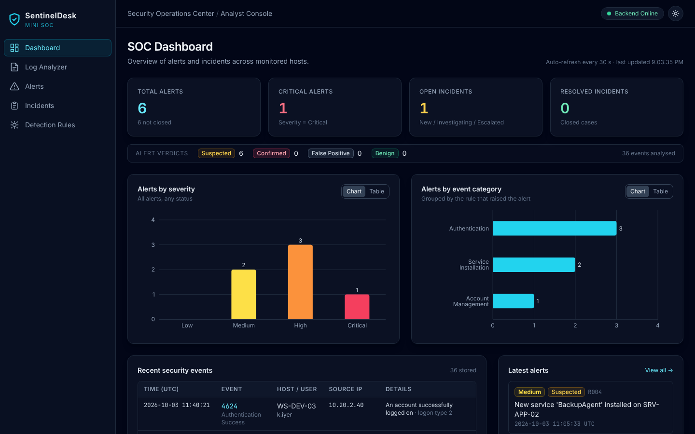
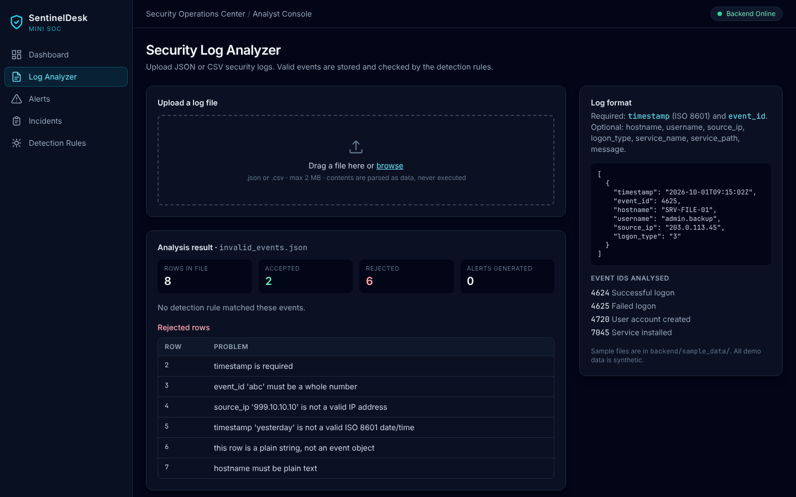
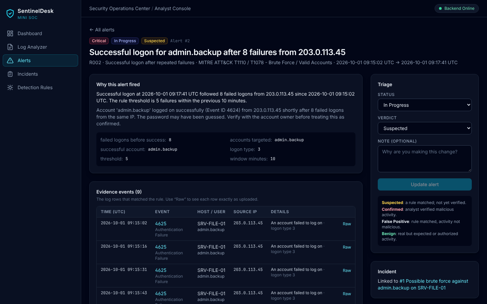
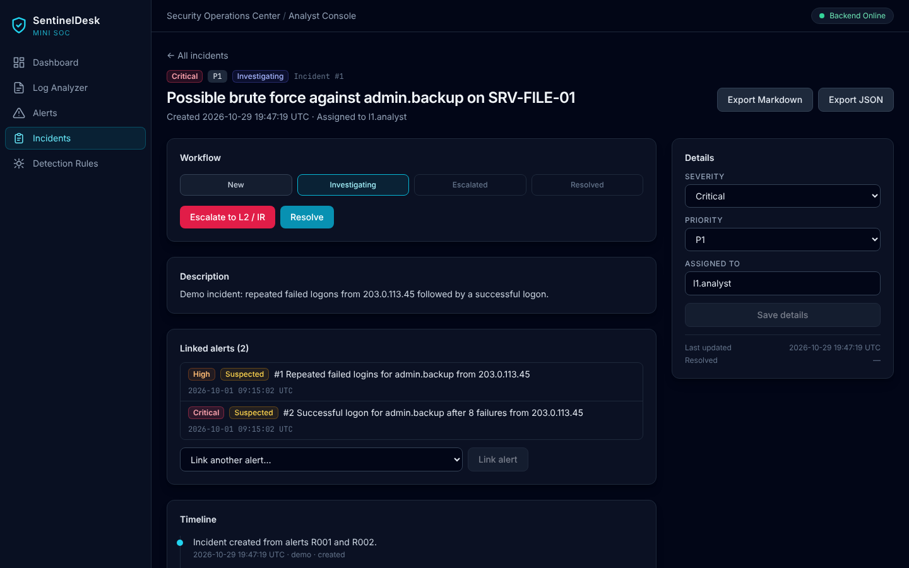
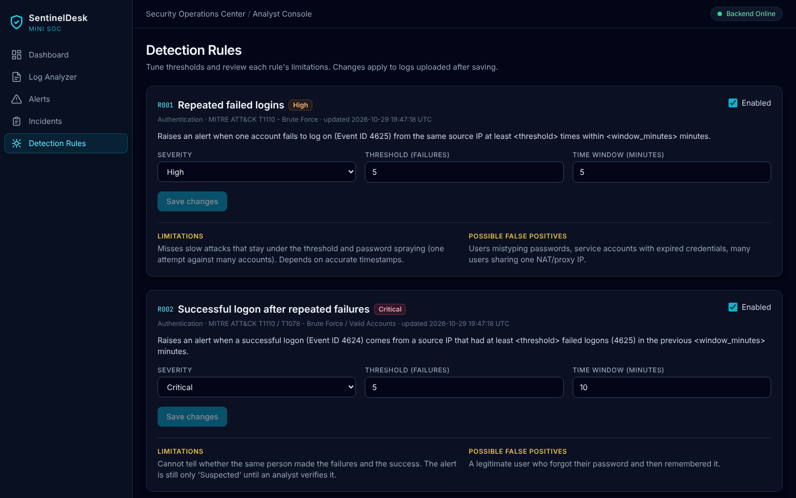
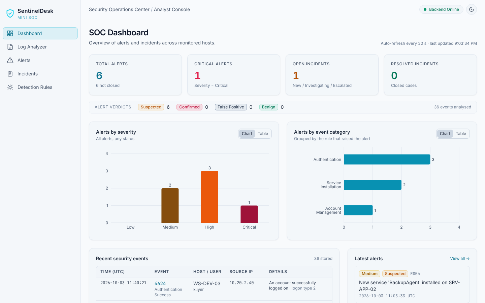

# SentinelDesk — Mini SOC Monitoring & Incident Response Platform

SentinelDesk is a small Security Operations Center (SOC) application built as a portfolio project for
SOC Analyst L1 roles. It ingests Windows-style security logs, runs detection rules, raises alerts with
evidence, and supports the analyst workflow: **triage → investigate → escalate → resolve → report**.

> All demo data is synthetic. It contains no real credentials, personal data, or malware.
> This is a learning project, not a production security tool.



## Features

| Area | What it does |
|---|---|
| **SOC Dashboard** | Total/critical alerts, open/resolved incidents, alert verdict counts, alerts by severity and by category (Recharts, with a table view), recent events and latest alerts. Refreshes every 30 s. |
| **Security Log Analyzer** | Upload JSON or CSV logs (drag and drop). File type, size, encoding and every row are validated. Bad rows are reported by row number and good rows are stored. Detection runs automatically. |
| **Detection Rules** | Four rules for Windows Event IDs 4624, 4625, 4720 and 7045, kept separate from the UI. Thresholds and windows can be tuned in the UI. Each rule documents its limitations and false positives. |
| **Alert Investigation** | Search and filter, the evidence events with raw log rows, related events (same IP, user or host within ±60 min), investigation notes, status, and verdict. A **Confirmed** verdict requires a written justification. |
| **Incident Management** | Create incidents from one or more alerts, with severity, priority P1–P4 and owner. Workflow **New → Investigating → Escalated → Resolved** (resolving needs a summary). Automatic timeline, notes, and **Markdown/JSON report export**. |
| **Dark / light mode** | Theme toggle (sun/moon button in the header). The first visit follows the operating-system setting, and your choice is remembered in the browser. The charts switch to colors checked for each background. |

| Log Analyzer | Alert investigation |
|---|---|
|  |  |
| **Incident** | **Detection rules** |
|  |  |
| **Light mode** | |
|  | |

## Architecture

```
Browser: React + Vite + Tailwind + Recharts (:5173)
        │  fetch() JSON over HTTP (CORS limited to the frontend origin)
        ▼
FastAPI backend (:8000)
   routers/     HTTP endpoints only: validation, status codes
   services/    log parsing & validation, ingestion, detection runner, report export
   detection/   rule logic in plain Python (no web or database code)
   models.py    SQLAlchemy ORM; all queries are parameterized
        ▼
SQLite: backend/data/sentineldesk.db
```

**Data flow:** upload → validate → store events → run enabled rules → alerts (always *Suspected*) →
analyst notes and verdict → incident → timeline → report.

### Tech stack
React 18, Vite 5, Tailwind CSS 3, Recharts 2, React Router 6 · Python 3.12+, FastAPI, SQLAlchemy 2,
Pydantic 2, SQLite · pytest · Git.

### Folder structure
```
sentineldesk/
├── backend/
│   ├── app/
│   │   ├── main.py, config.py, database.py, models.py, schemas.py, seed.py, demo_data.py
│   │   ├── routers/      health, logs, events, rules, alerts, incidents, dashboard
│   │   ├── services/     log_parser, ingest_service, detection_service, report_service
│   │   └── detection/    base, engine, event_catalog, rules/ (one file per rule)
│   ├── sample_data/      synthetic JSON/CSV logs (suspicious, normal, mixed, invalid)
│   ├── tests/            149 pytest tests
│   ├── requirements.txt  .env.example  pytest.ini
├── frontend/
│   ├── src/  api/client.js, components/, pages/, utils/
│   ├── package.json  vite.config.js  tailwind.config.js  .env.example
└── docs/screenshots/
```

## Quick start (Windows PowerShell)

Prerequisites: **Python 3.12+**, **Node.js 18+**, Git.

**1. Backend** (PowerShell window 1)
```powershell
cd sentineldesk\backend
python -m venv .venv
.\.venv\Scripts\Activate.ps1
pip install -r requirements.txt
Copy-Item .env.example .env
pytest -v
python -m app.demo_data --reset
uvicorn app.main:app --reload --port 8000
```
If `Activate.ps1` is blocked, run `Set-ExecutionPolicy -Scope Process -ExecutionPolicy Bypass` first.
API docs: http://localhost:8000/docs

**2. Frontend** (PowerShell window 2)
```powershell
cd sentineldesk\frontend
npm install
Copy-Item .env.example .env
npm run dev
```
Open http://localhost:5173. The header shows **Backend Online**.

### Demo data
`python -m app.demo_data --reset` **deletes all data** in the configured database, then loads the three sample
files: 36 events, 6 alerts, and one demo incident. Leave out `--reset` to add the samples to existing data.
You can also upload any file from `backend/sample_data/` on the Log Analyzer page.

### Suggested demo walkthrough (5 minutes)
1. **Dashboard:** explain the stat cards, the verdict strip and the two charts (toggle **Table**).
2. **Log Analyzer:** upload `invalid_events.json` to show validation, then `suspicious_events.json` to show 4 alerts.
3. **Alert R002** (success after failures): explain *why it fired*, open a raw event, check related events.
4. Add a note, then try **Confirmed**: it is blocked until a justification is written.
5. **Create incident**, move it through Investigating → Escalated → Resolved, then **Export Markdown**.
6. **Detection Rules:** raise R001's threshold and explain its false positives.

## Testing
```powershell
cd sentineldesk\backend
.\.venv\Scripts\Activate.ps1
pytest -v
```
149 tests cover the parser (every rejection reason), each detection rule (suspicious data alerts, normal data
stays quiet, threshold and window boundaries), and all API endpoints. That includes an SQL-injection attempt, the
Confirmed-needs-justification rule, incident status transitions, and HTML escaping in reports.
Each test uses a fresh temporary database. Frontend production build: `npm run build`.

## API reference
| Method | Path | Purpose |
|---|---|---|
| GET | `/api/health` | Backend and database status |
| POST | `/api/logs/upload` | Upload a `.json`/`.csv` log (multipart field `file`); returns counts, row errors, generated alerts |
| GET | `/api/logs/uploads` | Upload history |
| GET | `/api/events` | Events (filters: `event_id`, `category`, `username`, `hostname`, `source_ip`, `upload_id`, `q`; `limit`/`offset`) |
| GET | `/api/events/{id}` | One event with its raw row |
| GET / PUT | `/api/rules`, `/api/rules/{id}` | List rules / tune `enabled`, `severity`, `threshold`, `window_minutes` |
| GET | `/api/alerts` | Alerts (filters: `severity`, `status`, `verdict`, `rule_id`, `in_incident`, `q`) |
| GET / PATCH | `/api/alerts/{id}` | Alert detail / change `status`, `verdict` (+ `note`) |
| GET | `/api/alerts/{id}/related` | Related events |
| POST | `/api/alerts/{id}/notes` | Add a note |
| GET / POST | `/api/incidents` | List / create (with `alert_ids`) |
| GET / PATCH | `/api/incidents/{id}` | Detail / change status, severity, priority, owner, resolution |
| POST | `/api/incidents/{id}/notes`, `/api/incidents/{id}/alerts` | Timeline note / link more alerts |
| GET | `/api/incidents/{id}/report?format=markdown\|json` | Download report |
| GET | `/api/dashboard/summary` | Dashboard numbers |

## Log format
JSON (a list of events, or `{"events": [...]}`) or CSV with a header row.
Required: `timestamp` (ISO 8601; time zones are converted to UTC) and `event_id`. Optional: `hostname`,
`username`, `source_ip`, `logon_type`, `service_name`, `service_path`, `message`. Alternative names such as
`EventID`, `TimeCreated`, `Computer` and `IpAddress` are recognized. Unknown extra fields are kept in the raw row.

## Detection rules
| ID | Rule | Default logic (configurable) | Severity | MITRE |
|---|---|---|---|---|
| R001 | Repeated failed logins | ≥ 5 × 4625 for the same user + source IP within 5 min | High | T1110 |
| R002 | Successful logon after failures | 4624 from an IP with ≥ 5 × 4625 in the previous 10 min | Critical | T1110 / T1078 |
| R003 | New user account created | every 4720 | Medium | T1136.001 |
| R004 | New service installed | every 7045; High if the path is in Temp, AppData or Users\Public (text match only) | Medium / High | T1543.003 |

| Rule | Limitations | Possible false positives |
|---|---|---|
| R001 | Misses slow attacks below the threshold and password spraying | Mistyped passwords, stale service-account credentials, users behind one NAT IP |
| R002 | Cannot prove the same person made the failures and the success | A user who forgot and then remembered the password |
| R003 | Cannot see whether the creation was approved | Normal onboarding by IT |
| R004 | Only checks path text; attackers can use normal-looking paths | Software installs, updates, drivers, management agents |

## Security design
- **Uploads:** only `.json`/`.csv`, at most `MAX_UPLOAD_MB` (default 2) and `MAX_EVENTS_PER_FILE` (default 10,000).
  Only limit + 1 byte is read, binary or non-UTF-8 content is rejected, and every row is validated (timestamp,
  Event ID range, IP format, field lengths).
- **No execution:** files are parsed in memory with Python's `json`/`csv` modules and never saved as files.
  Command lines and service paths are stored and shown as text only.
- **SQL injection:** all database access goes through the SQLAlchemy ORM with bound parameters, and text search
  escapes `%`/`_`.
- **XSS:** React escapes all rendered text, raw log rows are shown inside `<pre>` as text, and Markdown reports
  escape `<`, `>` and `&`.
- **Path tricks:** uploaded filenames are reduced to a safe base name (`../../x.json` → `x.json`).
- **Secrets:** configuration comes from environment variables (`.env` is git-ignored; `.env.example` is committed).
- **Errors:** unexpected errors return a generic message; stack traces stay in the server log. CORS allows only
  the configured frontend origin.
- **Evidence-based verdicts:** every detection starts as **Suspected**. **Confirmed** requires an analyst
  justification, and reports state clearly when nothing has been confirmed.

## Known limitations
- No login or roles. The analyst name is a free-text label. Add authentication before any real use.
- Detection runs per upload, so there is no correlation across uploads, and re-uploading a file creates duplicate alerts.
- Changed thresholds apply to new uploads only; old logs are not re-scanned.
- SQLite and a single process: fine for a demo, not for high log volumes.
- Logs are uploaded by hand. There is no live collection (e.g. Windows Event Forwarding or Sysmon).

`.gitignore` already excludes `.env`, `.venv`, `node_modules`, `dist` and the SQLite database.
Before pushing, check that `git status` does not list any `.env` file.
